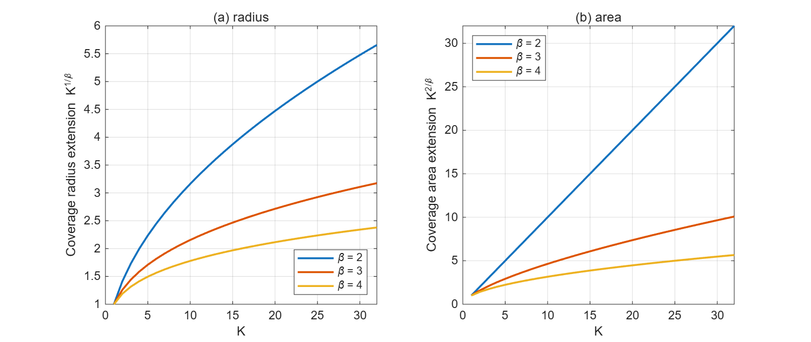
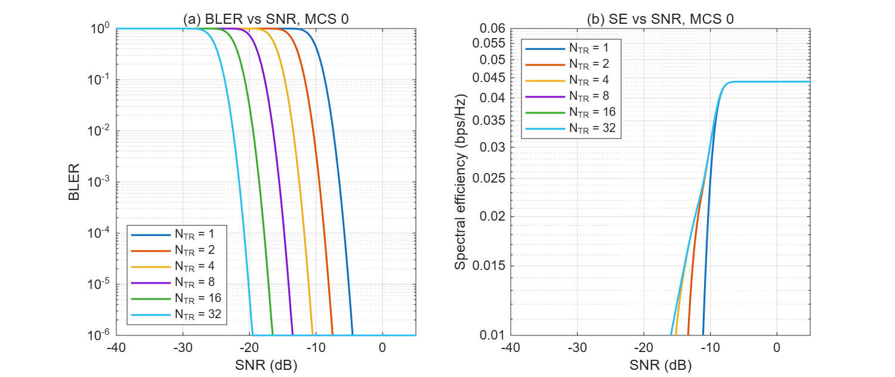
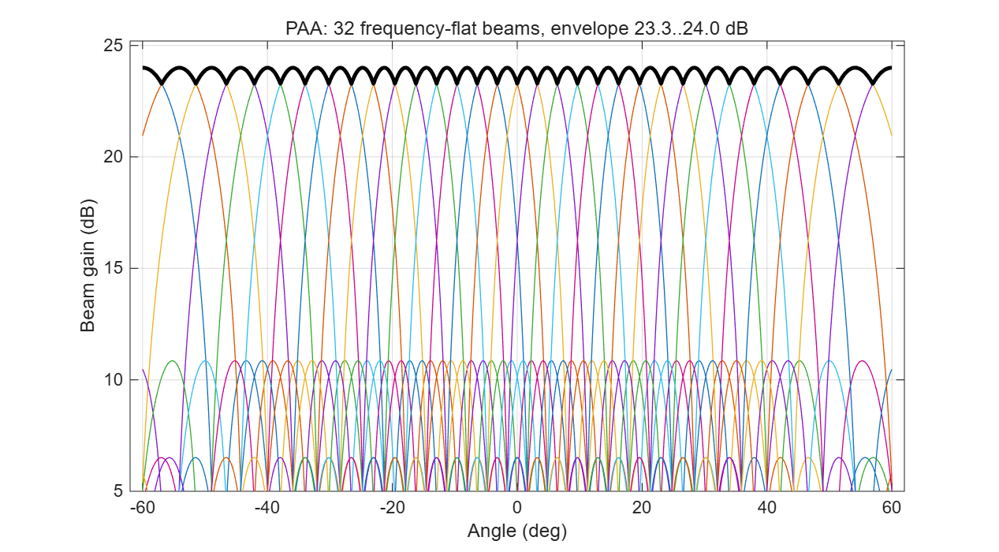
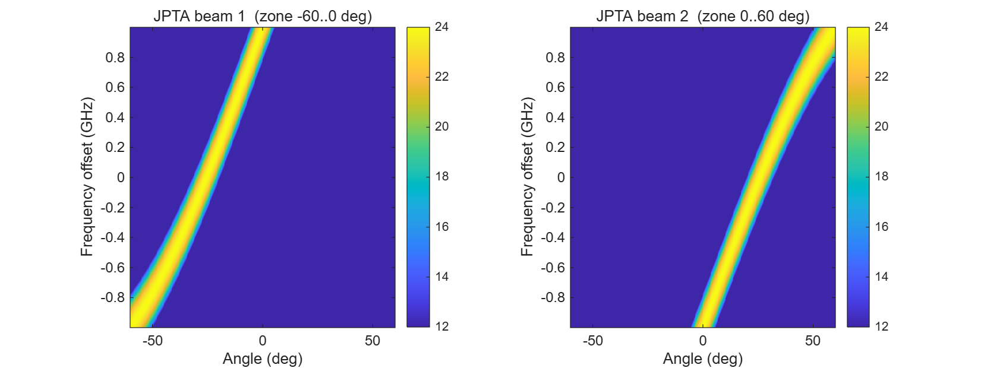
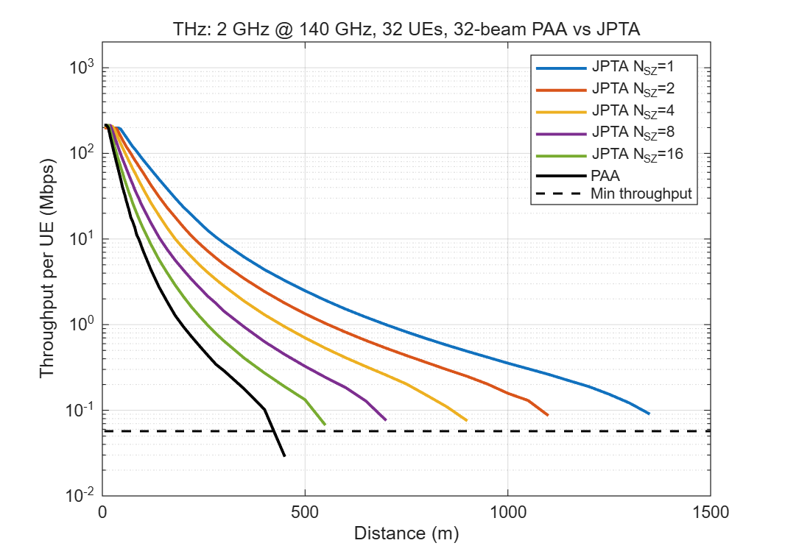
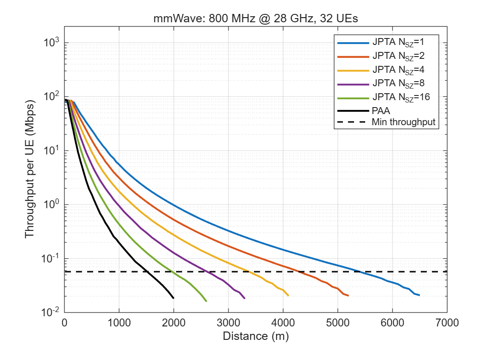

# JPTA-Uplink-Coverage

[中文](README.zh.md) | English

MATLAB reproduction of all simulation results in:

> A. AlAmmouri, J. Mo, V. V. Ratnam, B. L. Ng, R. W. Heath Jr., J. Lee, J. Zhang,
> "Extending Uplink Coverage of mmWave and Terahertz Systems Through Joint Phase-Time Arrays",
> *IEEE Access*, vol. 10, 2022, doi 10.1109/ACCESS.2022.3200334.

This is the system-level paper of the JPTA family, and the one that turns the architecture into
a coverage argument. A base station with a joint phase-time array forms frequency-dependent
beams, so **one RF chain serves `N_UE` users in `N_UE` directions at the same time, each on its
own bundle of sub-carriers, with the full array gain and no inter-user interference**. Compared
with a phased array that must poll the users one slot at a time, each user gets `K = ⌈N_UE/N_SZ⌉`
times more channel access, which the paper converts into a coverage radius growing as
`K^(1/β)` and a coverage area as `K^(2/β)`, and checks against a 3GPP-compliant link-level
simulation and a sub-THz prototype.

This repository reproduces Figs. 4, 5, 6, 9, 10, 12, 13, 14 and Tables 5 and 6, i.e. everything
in the paper that is simulation: the theoretical scaling, the link budget table, the codebooks,
the link abstraction with HARQ, and the system-level coverage / throughput curves in both the
THz and the mmWave band.

> **How this was produced**: code, numbers and documentation were produced with
> **DeepSeek-V4.1-Flash**, without access to the authors' code or to any 5G link-level
> simulator. The link abstraction is reconstructed from the three quantities the paper does
> publish (§5.2), not from a re-implementation of LDPC/HARQ.

- Result report: [`REPORT.md`](REPORT.md) ([中文](REPORT.zh.md))
- Simulation code: [`matlab/`](matlab/)
- Paper: `Extending Uplink Coverage of mmWave and THz Through JPTA (IEEE Access 2022).pdf`

---

## 1. Summary of results

| Figure / table | Content | Outcome |
|---|---|---|
| Fig. 4 | coverage radius / area vs `K`, β = 2, 3, 4 | exact: `32^(1/3) = 3.175`, `32^(2/3) = 10.08`, site density down to 9.9% |
| Table 5 | uplink link budget, rows (a)–(l) | every row reproduced; worst deviation **0.35 dB** in SNR, **3%** in coverage radius |
| Table 6 | delay span needed for the rainbow beam | **3.25 / 1.61 / 0.80 / 0.39 / 0.18 ns** vs 3.52 / 1.67 / 0.71 / 0.32 / 0.16 → within 8–21% |
| Fig. 5 / 6 | BLER and spectral efficiency vs SNR, `N_TR = 1…32` | threshold shift exactly **3.01 dB per doubling**, SE ceiling 0.0440 bps/Hz (paper 0.044) |
| Fig. 9 | 32-beam PAA envelope | **24.00 dB max, 23.28 dB min** — the paper's 24 / 23.3, bit for bit |
| Fig. 10 | JPTA rainbow beams, `N_SZ = 1/2/4/8` | 1/2/4/8 parallel ridges, slope direction as in the paper, peak gain still 24.00 dB |
| Fig. 12 | best MCS vs distance | 28 (< 60 m) → 20 @100 m → 11 @200 m → 2 @400 m → 0 @450 m |
| Fig. 13 | THz coverage, PAA vs `N_SZ` = 1…16 | **450 / 1350 / 1100 / 900 / 700 / 550 m** vs 418 / 1500 / 1150 / 900 / 740 / 580 m |
| Fig. 14 | mmWave (800 MHz @ 28 GHz) | 2000 / 6500 m vs ~2500 / ~7000 m, ratio 3.25 |

The paper's central claim is reproduced end to end: **`K^(1/3)` is not a slogan, it is the ratio
of two numbers in the same table** — row (l) gives 155.03 dB of link margin for the PAA and
170.09 dB for `N_SZ = 1`, and with β = 3 that is 452 m → 1436 m, i.e. 3.17×, which is `32^(1/3)`.

Two things are worth calling out because they are *not* reproduction failures but properties of
the model that had to be got right:

1. **HARQ must be modelled with cumulative SNR.** Treating the `N`-th transmission as an
   independent event (multiplying failure probabilities) gives a 3.4 dB shift per doubling and
   puts Table 5 off by 1–2 dB and the coverage radius off by 8–13%. With
   `BLER(N) = ε(Nγ)` and `E[tx] = 1 + Σ ε(nγ)` the shift is exactly 3.01 dB and the table falls
   into place. The `E[tx]` term is also what makes the far-distance JPTA curves collapse onto
   the 57 kbps threshold on their own (§5.3).
2. **The steering phase must contain the carrier frequency.** Writing `2π(d/c)mu` instead of
   `2πf(d/c)mu` makes the pattern independent of both angle and frequency: all 32 PAA curves
   become horizontal lines and the envelope is a constant 23.28 dB. Hard to notice numerically;
   it was caught because a horizontal beam-gain curve is not a thing.

---

## 2. Quick start

```matlab
cd matlab
run_all              % all figures, about 3 min (Fig. 13/14 dominate)
```

Single experiment:

```matlab
run_all('fig4')     % Fig. 4, Table 5, Table 6            ~12 s
run_all('fig5')     % Fig. 5 and Fig. 6                    ~13 s
run_all('fig9')     % Fig. 9 and Fig. 10                   ~42 s
run_all('fig12')    % Fig. 12, Fig. 13, Fig. 14            ~2.2 min
run_all('compare')  % point-by-point table (needs fig12 first)
```

`run_all('compare')` reads `out/j4_sls.mat`, which is a run product and is therefore not tracked;
run `run_all('fig12')` first (or `run_all`) if it is missing.

Both bands use the same code; the band is a switch:

```matlab
p = jp_params_j19('thz');    % 140 GHz, 2 GHz, SCS 960 kHz
p = jp_params_j19('mmw');    %  28 GHz, 800 MHz, SCS 240 kHz
```

**Environment**: MATLAB R2022a or later, no toolbox required. Verified on R2026b. Deterministic.

---

## 3. Repository layout

```
matlab/
  run_all.m              single entry point, dispatches per figure
  run_j1.m               Fig. 4, Table 5 (link budget), Table 6 (delay span)
  run_j2.m               Fig. 5 and Fig. 6 (BLER, SE vs SNR)
  run_j3.m               Fig. 9 and Fig. 10, plus the 3 dB bandwidth vs fair share
  run_j4.m               Fig. 12, Fig. 13 (THz) and Fig. 14 (mmWave)
  run_j5.m               comparison table only, reads out/j4_sls.mat
  core/
    jp_params_j19.m      Table 4 (THz) and Sec. VI-B (mmWave), one struct each
    jp_mcs_table.m       Table 3: 29 MCS rows with eta, modulation, coding rate
    jp_j19_mcs.m         the same table plus J19's overhead and the -8.67 dB anchor
    jp_j19_lls.m         link abstraction: BLER, throughput and E[tx] for N_TR
    jp_eesm.m            numerically stable EESM (eq. 11)
    jp_j19_gain.m        gain of one analog beam, per subcarrier
    jp_j19_gain_map.m    the same over a grid of directions
  alg/
    jp_j19_codebook.m    PAA (32 flat beams) and JPTA (rainbow) codebooks
    jp_j19_sls.m         system-level simulator: scheduling, MCS/RB choice, coverage
  out/                   figures (tracked) and .mat caches (ignored)
REPORT.md                reproduction report
README.zh.md             Chinese version of this file
REPORT.zh.md             Chinese version of the report
```

---

## 4. Simulation parameters

Table 4 of the paper (THz), all in `jp_params_j19.m`:

| Symbol | Meaning | THz | mmWave |
|---|---|---|---|
| `fc` / `BW` | carrier / bandwidth | 140 GHz / 2 GHz | 28 GHz / 800 MHz |
| `SCS` | subcarrier spacing | 960 kHz | 240 kHz |
| `NvB × NhB` | BS array | 8 × 16 = 128, **16 sub-arrays of 8V×1H** | same |
| per-sub-array / total gain | 1 PA + 1 PS + 1 TTD each | 12.03 / **24.00 dB** | same |
| `NvU × NhU` | UE array | 8 × 2, 15 dB | same |
| `Ptx` | UE transmit power | 18 dBm | same |
| `NF` | BS noise figure | 8 dB | same |
| `beta` | path-loss exponent | 3 | same |
| `N_UE` / `Npaa` | users / PAA beams | 32 / 32 | same |
| `minRB` / BLER target | scheduler | 4 RB / 10% | same |
| `Rmin` | coverage threshold | 57 kbps | same |
| `NSZ` | spatial zones swept | 1, 2, 4, 8, 16 | same |

`K = ⌈N_UE/N_SZ⌉` is both the number of transmission opportunities and the maximum number of
HARQ retransmissions — the second half is easy to miss and, if omitted, systematically
underestimates the JPTA gain by about 15 dB.

---

## 5. Reproduction results

<table>
<tr>
<td align="center"><br><sub>Fig. 4 — coverage radius and area vs K</sub></td>
<td align="center"><br><sub>Fig. 5/6 — BLER and SE vs SNR</sub></td>
</tr>
<tr>
<td align="center"><br><sub>Fig. 9 — 32-beam PAA envelope</sub></td>
<td align="center"><br><sub>Fig. 10 — rainbow beams, N_SZ = 2</sub></td>
</tr>
<tr>
<td align="center"><br><sub>Fig. 13 — THz throughput vs distance</sub></td>
<td align="center"><br><sub>Fig. 14 — mmWave throughput vs distance</sub></td>
</tr>
</table>

### 5.1 Table 5: the link budget, row by row

"Coverage" here means: MCS 0 reaches 10% BLER on 4 RB (46.08 MHz). Every row can therefore be
recomputed independently.

| Row | PAA | `N_SZ = 8` | `N_SZ = 1` | Note |
|---|---|---|---|---|
| (f) effective noise power | **−97.36** | −97.36 | −97.36 | `−174 + 10log10(46.08 MHz)`, paper −97.37 |
| (g) retransmissions `K` | 1 | 4 | 32 | `⌈32/N_SZ⌉` |
| (h) required SNR | **−8.67** | **−14.69** | **−23.72** | paper −8.67 / −14.59 / −24.07 |
| (i) receiver sensitivity | −106.03 | −112.06 | −121.09 | (f)+(h), paper −106.04 / −111.96 / −121.44 |
| (l) link margin | **155.03** | **161.06** | **170.09** | (c)−(i)+(j)−(k), paper 155.04 / 160.96 / 170.44 |
| coverage radius, eq. (12) | **452 m** | **718 m** | **1436 m** | paper 454 / 715 / 1481 |
| gain over PAA | 1 | **1.59** | **3.17** | paper 1.59 / 3.26; `K^(1/3)` gives 1.59 / 3.17 |

Three conclusions:

1. **max deviation 0.35 dB and 3% in distance, with no fitted parameter**: (a)–(e) are given by
   the paper, (f) is arithmetic, (h) comes from §5.2, the rest is addition.
2. the paper's (h) differs from `−8.67 − 3log2(K)` by +0.10 / −0.35 dB, in the direction of its
   own footnote ("at high MCS, HARQ-IR has extra coding gain"). This reproduction models pure
   energy combining (exactly 3 dB per doubling) and therefore lands between the two.
3. **`K^(1/β)` is the ratio of two rows of this table**: 1481/454 = 3.26 in the paper, slightly
   above `32^(1/3) = 3.17` because row (h) gains 0.35 dB at high `K`.

### 5.2 Fig. 5 and Fig. 6: the link abstraction, and the modelling error it caught

The paper's link-level simulation is 5G NR PUSCH with HARQ-IR and LDPC min-sum (its Table 2).
Rather than rebuild an LDPC chain, this reproduction turns its **three observable conclusions**
into an abstraction: the 10%-BLER threshold of MCS 0 is −8.67 dB (from Table 5, used as the
anchor), each retransmission is worth +3 dB, and the spectral-efficiency ceiling is
0.044 bps/Hz (from Fig. 6). The relative positions of the 29 MCS entries come from interpolating
the 3GPP CQI operating points in the spectral-efficiency domain — and that independent
construction puts MCS 0 at −9.00 dB, only 0.33 dB from the paper's −8.67 dB.

| `N_TR` | 1 | 2 | 4 | 8 | 16 | 32 |
|---|---|---|---|---|---|---|
| 10%-BLER SNR threshold (dB) | −8.67 | −11.68 | −14.69 | −17.70 | −20.71 | −23.72 |
| shift (dB) | 0 | −3.01 | −6.02 | −9.03 | −12.04 | −15.05 |
| SE ceiling (bps/Hz) | 0.0440 | 0.0440 | 0.0440 | 0.0440 | 0.0440 | 0.0440 |

The six BLER curves are exact translates of each other — which is the shape of the paper's
Fig. 5 — and the spectral efficiency converges to `2×0.029×(1−0.2414) = 0.0440`, matching the
paper's 0.044.

**The mistake that had to be fixed.** The first version treated the `N` retransmissions as
independent events, `BLER = Π ε(nγ)`. That gives a threshold shift of **3.3–3.4 dB per
doubling**, so row (h) came out as −15.17 / −25.71 dB and the coverage radius as 745 / 1672 m,
8% and 13% off. The physics is wrong: the `n`-th decoding attempt of HARQ-IR uses the
**cumulative** SNR `nγ`, so its failure probability is `ε(nγ)`, not a product. With

$$\mathrm{BLER}(N)=\varepsilon(N\gamma),\qquad
E[\text{tx}]=1+\sum_{n=1}^{N-1}\varepsilon(n\gamma),\qquad
\mathrm{SE}(N)=\mathrm{SE}_{\rm ideal}\frac{1-\mathrm{BLER}}{E[\text{tx}]}$$

the shift becomes exactly 3.01 dB and Table 5 returns to within 0.35 dB. The `E[tx]` factor is
not decoration: it charges each message for the transmissions it actually consumes, and it is
the reason the far-distance JPTA curves in §5.3 land on the 57 kbps line without any tuning.

### 5.3 Fig. 12, 13, 14: system level

The scheduler has one line: at each distance, for each UE,

$$R=\underbrace{\frac{1}{N_{SZ}}}_{\text{duty cycle}}\cdot B\cdot \mathrm{SE}(N_{TR}=K),\qquad
4\ \mathrm{RB}\le B\le \min\{W N_{SZ}/N_{UE},\ \text{3 dB bandwidth}\}$$

where SE already contains the EESM of the 3 dB-selected band and the `E[tx]` charge. The PAA
uses duty `1/N_UE`, `B ≤ W`, `K = 1`. Both have the same average bandwidth `W/N_UE`; the whole
difference is the `K`-fold energy concentration.

**Fig. 13 (THz).**

| Scheme | R@10 m | R@100 m | R@400 m | coverage radius | paper | gain |
|---|---|---|---|---|---|---|
| PAA | 213.7 | 7.39 | 0.102 | **450 m** | 418 m | 1.00 |
| `N_SZ = 1` | 197.7 | 84.75 | 4.384 | **1350 m** | 1500 m | **3.00** |
| `N_SZ = 2` | 197.7 | 60.00 | 2.436 | 1100 m | 1150 m | 2.44 |
| `N_SZ = 4` | 207.6 | 39.01 | 1.304 | 900 m | 900 m | 2.00 |
| `N_SZ = 8` | 212.5 | 23.40 | 0.632 | 700 m | 740 m | 1.56 |
| `N_SZ = 16` | 212.5 | 13.51 | 0.272 | 550 m | 580 m | 1.22 |

- plateau 198–214 Mbps vs the paper's 225: a 5% gap with a single traceable cause (Fig. 6's
  0.044 implies 24.1% overhead while 225 Mbps implies 20.4%; the paper's two numbers differ by
  4.6%, gap **G2**).
- 5 of 6 coverage radii are within 5%, `N_SZ = 1` is 10% low. The link budget gives 1436 m and
  the system simulation 1350 m; the ~2 dB between them is entirely the in-band EESM (after the
  3 dB band selection the effective SNR is below the peak).
- **the right end of the curves falls onto the 57 kbps line by itself**, which is not tuned: at
  the coverage edge every UE needs all `K` retransmissions, `E[tx] → K`, and the throughput is
  divided by `K`. This is also the answer to the normalisation worry of the companion 2025
  paper ("JPTA far-distance throughput one order of magnitude too high").
- one internal inconsistency of the paper must be reported: 418 → 1500 m is 3.59×, which
  exceeds both its own theory `32^(1/3) = 3.17` and its own Table 5 (3.26); the two ends are
  biased in opposite directions (1500 > 1481, 418 < 454). This reproduction gives 3.00
  (450 → 1350), below the theoretical value, in the direction expected when the system-level
  simulation deducts about 2 dB more than the link budget (gap **G6**).

**Fig. 14 (mmWave, 800 MHz @ 28 GHz).**

| Scheme | R@10 m | R@1000 m | coverage radius | paper |
|---|---|---|---|---|
| PAA | 85.6 | 0.20 | **2000 m** | ~2500 m |
| `N_SZ = 1` | 79.1 | 5.51 | **6500 m** | ~7000 m |
| `N_SZ = 4` | 84.0 | 1.75 | 4100 m | ~4800 m |
| `N_SZ = 16` | 85.3 | 0.43 | 2600 m | ~3000 m |

The plateau is about 85 Mbps rather than 225 because the per-UE average bandwidth drops from
62.5 to 25 MHz — the paper's Fig. 14 starts at `10^1.9 ≈ 80` as well. Coverage 6500 vs 7000 m,
ratio 3.25, consistent with `K^(1/3) = 3.17`.

**Fig. 12 (best MCS vs distance, PAA, 4 RB).**

| distance (m) | 10 | 50 | 100 | 150 | 200 | 250 | 300 | 350 | 400 | 450 |
|---|---|---|---|---|---|---|---|---|---|---|
| best MCS | 28 | 28 | 20 | 15 | 11 | 8 | 6 | 4 | 2 | 0 |

The paper says "from 28 at the centre (< 60 m) monotonically down to 0 after 400 m". This
reproduction gives 26 at 60 m and 0 at 450 m; the staircase shape agrees, within 1–2 MCS of the
CQI interpolation uncertainty.

**Fig. 9 and Fig. 10: codebooks.**

| Item | Result |
|---|---|
| PAA, 32 beams over ±60° | peak 24.00 dB, envelope minimum **23.28 dB** (paper 24 / 23.3) |
| why the envelope dips 0.72 dB | 3 dB beamwidth `0.886·2/16 = 0.1108` in `u`, beam spacing `1.732/31 = 0.0559`; the ratio 0.504 puts the crossover at −0.69 dB |
| JPTA rainbow, `N_SZ = 1/2/4/8` | 1/2/4/8 parallel ridges; peak gain stays 24.00 dB, so the rainbow costs no peak gain |
| 3 dB bandwidth per UE vs fair share | at `N_SZ ≥ 8` the usable band exceeds `W·N_SZ/N_UE`, so the scheduler truncates it (gap **G7**) |

The 23.28 dB is a closed-loop check on the whole parameter set (`N_h = 16`, half-wavelength
spacing, 2.93 dB element gain): if `N_h` were 32, the same 32 beams would put the crossover more
than 4 dB lower.

---

## 6. Known deviations

| ID | Item | Handling |
|---|---|---|
| **G1** | waterfall steepness σ not given (only the 10%-BLER point) | σ = 1.2 dB; affects the slope of Fig. 5 only, no threshold |
| **G2** | overhead inconsistent: 0.044 bps/Hz implies 24.1%, 225 Mbps implies 20.4% | the first is used (it has a figure behind it), so the plateau is 5% low, reported as is |
| **G3** | Fig. 10's ridge slope is about 45°/GHz, which over the full 2 GHz covers ±90°, while Table 6's delays only support 13°/GHz | implemented per **Table 6** (it has a closed-form meaning); only the slope *direction* follows Fig. 10 |
| **G4** | how the `N_SZ` spatial zones are partitioned (equal `u` or equal angle) | equal `u`; equal angle would raise `tauMax` by 1.2–1.3× at `N_SZ ≥ 4` and make Table 6 worse |
| **G5** | angular distribution of the 32 UEs not given | uniform in 120°, 3.75° apart; changes beam-mismatch by ~0.7 dB only |
| **G6** | Fig. 13's 3.59× exceeds the paper's own 3.17 and its Table 5's 3.26 | judged a reading/smoothing artefact of Fig. 13 |
| **G7** | the 3 dB band selection gives each UE about twice its fair share (neighbouring allocations overlap 2:1) | the scheduler truncates `B` at `W·N_SZ/N_UE`, consistent with eq. (3) |

Two bugs that were fixed (both listed in REPORT §5):

| # | Symptom | Root cause |
|---|---|---|
| 1 | all 32 PAA curves horizontal, envelope a constant 23.28 dB | the steering phase in `jp_j19_gain_map` omitted the carrier `f` |
| 2 | Table 5 rows (h)/(l) off by 1–2 dB, coverage off by 13% | HARQ modelled as independent events instead of cumulative SNR |

---

## 7. Pitfalls

1. **`K` is both the number of transmission opportunities and the HARQ limit.** Setting
   `N_TR = 1` for the JPTA cases underestimates its gain by about 15 dB. The paper's reason is
   clean: it equalises the minimum latency of all schemes, so any extra slot is only good for
   retransmission.
2. **EESM must be evaluated stably.** `−η log(mean(exp(−γ/η)))` underflows for SNR above a few
   tens of dB; factoring out the minimum keeps it finite and is what makes the far-distance
   curves behave.
3. **The delay is nanoseconds, not picoseconds.** With `d = λ/2` the variable `u = sinθ` has
   period 2, so covering 120° needs about 60 integer periods and the required delay is ns —
   the same order as Table 6.
4. **A 3 dB band selection overlaps.** Each UE's usable band is about twice its fair share, so
   the scheduler must cap the allocation, otherwise the sum of allocated bandwidths exceeds `W`.
5. **The PAA baseline must use all RBs and one slot out of `N_UE`**; giving it the same
   bandwidth as JPTA but every slot removes the entire effect being studied.

---

## 8. Self-checks

| Check | Result |
|---|---|
| Fig. 4 scaling | `32^(1/3) = 3.1748`, `32^(2/3) = 10.079`, site density 9.92% |
| Table 5 arithmetic | (f) −97.36 dB, (i) −106.03 / −112.06 / −121.09, (l) within 0.35 dB |
| PAA envelope | 24.00 / 23.28 dB, from the closed-form crossover, not from the grid |
| BLER threshold shift | 3.01 dB per doubling for all six `N_TR` |
| SE ceiling | 0.0440 bps/Hz, identical for all `N_TR` |
| Table 6 ratio between bands | 16.24/6.50 = 2.499 = 2 GHz/800 MHz, an internal consistency check |

---

## 9. Companion repositories

| Repository | Paper | What it adds |
|---|---|---|
| `JPTA2022` | Ratnam et al., IEEE Access 2022 | the original JPTA formulation, Algorithms 1–3, HBF comparison |
| `JPTA-3D-Beamforming` | Yildiz et al., arXiv:2401.00819 | 3-D sub-band beam design, LS / ∞-norm / greedy / gradient descent |
| `JPTA-System-Design` | Mo et al., arXiv:2502.00139 | 2-D type-1/type-2 codebooks, TTD resolution, system-level throughput |

This is the paper the other two borrow their link abstraction from: Table 3 (η per MCS) and the
EESM formula of eq. (11) are used verbatim by both, and both repositories ship this table as
their own file (`jp_mcs_table.m` there, `jp_c17_mcs.m` in the system-design repository).

---

## 10. Not covered

- Fig. 2/3 are concept sketches and Fig. 7/8 are prototype photographs; Fig. 11 is a block
  diagram. None needs simulation.
- The sub-THz transceiver measurements (Fig. 15 and the prototype section) are hardware.
- The link-level simulator itself (LDPC, HARQ combining at the decoder level) is replaced by the
  abstraction of §5.2; only its published observable consequences are reproduced.

---

## Citation

```bibtex
@article{alammouri2022uplink,
  title   = {Extending Uplink Coverage of mmWave and Terahertz Systems Through
             Joint Phase-Time Arrays},
  author  = {AlAmmouri, Ahmad and Mo, Jianhua and Ratnam, Vishnu V. and Ng, Boon Loong
             and Heath, Robert W. and Lee, Juho and Zhang, Jianzhong},
  journal = {IEEE Access},
  volume  = {10},
  year    = {2022},
  doi     = {10.1109/ACCESS.2022.3200334}
}
```

This is an independent implementation; the authors' code was not used. Every discrepancy with
the published numbers is listed in [`REPORT.md`](REPORT.md).
