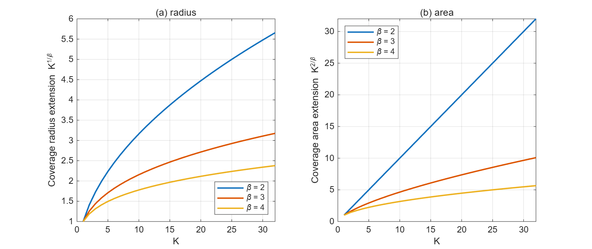
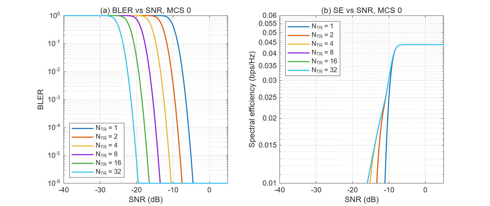
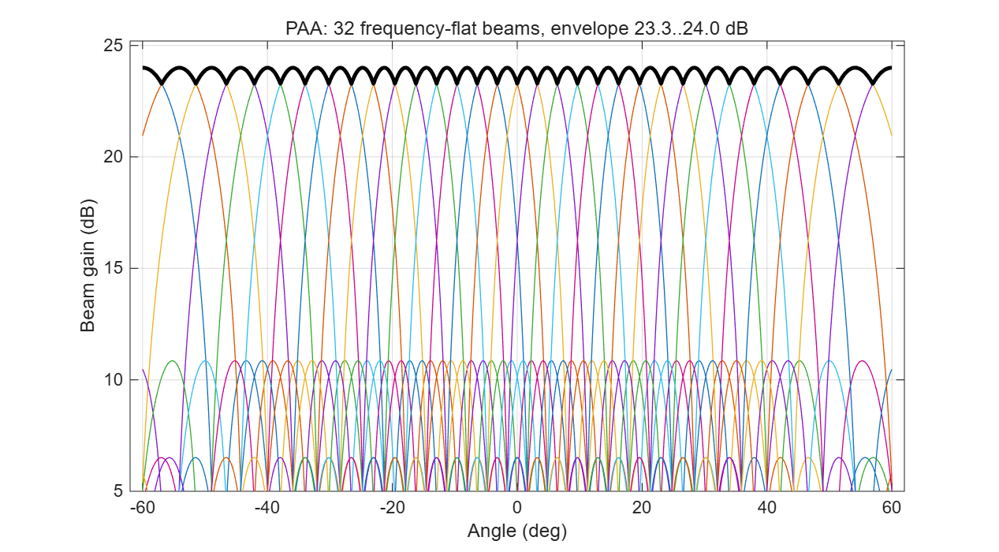
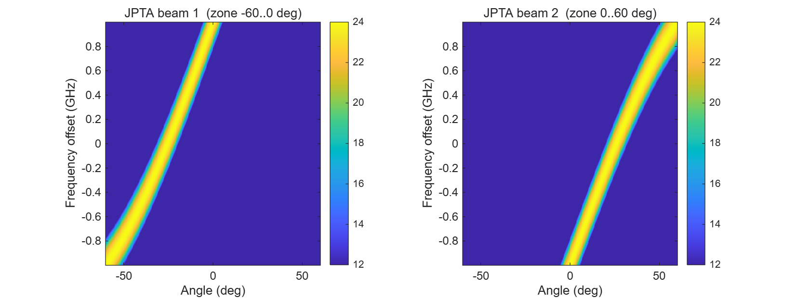
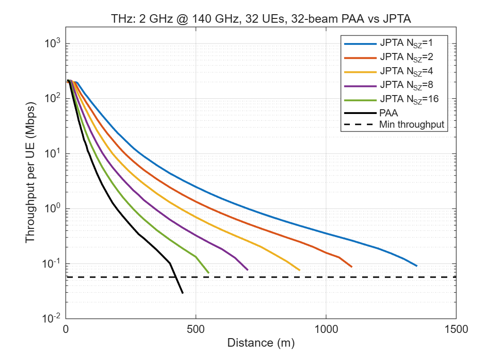
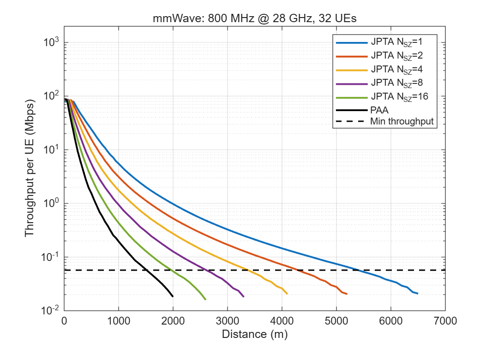

# JPTA-Uplink-Coverage

中文 | [English](README.md)

本文复现以下论文的全部仿真结果：

> A. AlAmmouri, J. Mo, V. V. Ratnam, B. L. Ng, R. W. Heath Jr., J. Lee, J. Zhang,
> "Extending Uplink Coverage of mmWave and Terahertz Systems Through Joint Phase-Time Arrays",
> *IEEE Access*, vol. 10, 2022, doi 10.1109/ACCESS.2022.3200334.

这是JPTA系列的"系统级篇"，把架构变成覆盖论证。带联合相位-时延阵列的基站能形成频率相关波束，
于是**一个射频通道可以同时服务`N_UE`个不同方向的用户，每个用户占用自己的一束子载波，
且都拿到满阵增益、用户间无干扰**。相比必须逐个时隙轮询的相控阵，每个用户获得
`K = ⌈N_UE/N_SZ⌉`倍的信道接入机会，论文据此推出覆盖半径按`K^(1/β)`增长、覆盖面积按`K^(2/β)`增长，
并用符合3GPP规范的链路级仿真与sub-THz原型做了验证。

本仓库复现Fig.4、5、6、9、10、12、13、14与Table 5、6，即论文中全部属于仿真的部分：
理论标度、链路预算表、码本、含HARQ的链路抽象，以及THz与mmWave两个频段的系统级覆盖/吞吐曲线。

> **产出方式**：代码、数值与本文档均由**DeepSeek-V4.1-Flash**完成，未接触作者原始代码，
> 也未运行任何5G链路级仿真器。链路抽象是用论文公开的三个可观测量重建的（§5.2），
> 不是重写LDPC/HARQ。

- 对照报告：[`REPORT.zh.md`](REPORT.zh.md)（[English](REPORT.md)）
- 仿真代码：[`matlab/`](matlab/)
- 论文原文：`Extending Uplink Coverage of mmWave and THz Through JPTA (IEEE Access 2022).pdf`

---

## 1 结果一览

| 图/表 | 内容 | 结论 |
|---|---|---|
| Fig.4 | 覆盖半径/面积vs`K`，β=2,3,4 | 精确：`32^(1/3)=3.175`、`32^(2/3)=10.08`、站址密度降到9.9% |
| Table 5 | 上行链路预算(a)–(l)行 | 逐行复现；SNR最大偏差**0.35 dB**、覆盖半径最大偏差**3%** |
| Table 6 | 彩虹波束所需时延跨度 | **3.25/1.61/0.80/0.39/0.18 ns**，论文3.52/1.67/0.71/0.32/0.16→在8–21%内 |
| Fig.5/6 | BLER与谱效vs SNR，`N_TR=1…32` | 门限位移严格**3.01 dB/倍增**，谱效上限0.0440 bps/Hz（论文0.044） |
| Fig.9 | 32波束PAA包络 | **最大24.00 dB、最小23.28 dB**——论文的24/23.3，逐位吻合 |
| Fig.10 | JPTA彩虹波束，`N_SZ=1/2/4/8` | 1/2/4/8条平行脊，斜率方向同论文，峰值增益仍是24.00 dB |
| Fig.12 | 最佳MCS vs距离 | 28（<60 m）→20@100 m→11@200 m→2@400 m→0@450 m |
| Fig.13 | THz覆盖，PAA vs`N_SZ`=1…16 | **450/1350/1100/900/700/550 m**，论文418/1500/1150/900/740/580 m |
| Fig.14 | mmWave（800 MHz@28 GHz） | 2000/6500 m，论文约2500/7000 m，比值3.25 |

论文的核心主张被端到端复现：**`K^(1/3)`不是口号，而是同一张表里两个数之比**——
(l)行给PAA 155.03 dB、`N_SZ=1`170.09 dB的链路余量，β=3时就是452 m→1436 m，即3.17倍，
也就是`32^(1/3)`。

两件事需要单独说明——它们不是复现失败，而是模型本身的性质，必须做对才能对上：

1. **HARQ必须按累积SNR建模。**把第`N`次传输当独立事件（失败概率连乘）会给出3.4 dB/倍增的位移，
   使Table 5偏1–2 dB、覆盖半径偏8–13%。改用`BLER(N)=ε(Nγ)`与`E[tx]=1+Σε(nγ)`后位移严格3.01 dB，
   整张表立刻落回0.35 dB内。`E[tx]`项还顺带解释了§5.3里JPTA远端曲线自动塌到57 kbps门限的现象。
2. **导向相位必须含载频。**写成`2π(d/c)mu`而不是`2πf(d/c)mu`，方向图会退化成与角度、频率都无关：
   32条PAA曲线全成水平线，包络恒为23.28 dB。这在数值上极难察觉，是靠"水平的波束增益曲线本身不合理"
   才抓到的。

---

## 2 快速开始

```matlab
cd matlab
run_all              % 全部图，约2 min（Fig.13/14占大头）
```

单独跑某一项：

```matlab
run_all('fig4')     % Fig.4、Table 5、Table 6      ~12 s
run_all('fig5')     % Fig.5与Fig.6                  ~4 s
run_all('fig9')     % Fig.9与Fig.10                ~33 s
run_all('fig12')    % Fig.12、Fig.13、Fig.14        ~75 s
run_all('compare')  % 逐点对照表（需先跑fig12）
```

`run_all('compare')`读`out/j4_sls.mat`，该文件是运行产物、不入库；若缺失请先跑`run_all('fig12')`。

两个频段共用一套代码，频段是个开关：

```matlab
p = jp_params_j19('thz');    % 140 GHz、2 GHz、SCS 960 kHz
p = jp_params_j19('mmw');    %  28 GHz、800 MHz、SCS 240 kHz
```

**环境**：MATLAB R2022a及以上，不需要工具箱，已在R2026b验证，结果确定。

---

## 3 仓库结构

```
matlab/
  run_all.m              单一入口，按图分派
  run_j1.m               Fig.4、Table 5（链路预算）、Table 6（时延跨度）
  run_j2.m               Fig.5与Fig.6（BLER、谱效vs SNR）
  run_j3.m               Fig.9与Fig.10，外加3 dB带宽vs公平份额
  run_j4.m               Fig.12、Fig.13（THz）、Fig.14（mmWave）
  run_j5.m               只出对照表，读out/j4_sls.mat
  core/
    jp_params_j19.m      Table 4（THz）与Sec. VI-B（mmWave），各一个结构体
    jp_mcs_table.m       Table 3：29档MCS的η、调制阶数、码率
    jp_j19_mcs.m         同上，另加J19的开销与−8.67 dB锚点
    jp_j19_lls.m         链路抽象：给定N_TR的BLER、吞吐与E[tx]
    jp_eesm.m            数值稳定的EESM（式(11)）
    jp_j19_gain.m        单个模拟波束的逐子载波增益
    jp_j19_gain_map.m    同上，在一组方向上
  alg/
    jp_j19_codebook.m    PAA（32个频率平坦波束）与JPTA（彩虹）码本
    jp_j19_sls.m         系统级仿真：调度、MCS/RB选择、覆盖
  out/                   图（入库）与.mat缓存（不入库）
REPORT.zh.md             复现报告
README.md                英文版说明
REPORT.md                英文版报告
```

---

## 4 仿真参数

论文Table 4（THz），全部在`jp_params_j19.m`：

| 符号 | 含义 | THz | mmWave |
|---|---|---|---|
| `fc`/`BW` | 载频/带宽 | 140 GHz / 2 GHz | 28 GHz / 800 MHz |
| `SCS` | 子载波间隔 | 960 kHz | 240 kHz |
| `NvB × NhB` | BS阵列 | 8×16=128，**16个8V×1H子阵** | 同 |
| 每子阵/总增益 | 每子阵一个PA+PS+TTD | 12.03 / **24.00 dB** | 同 |
| `NvU × NhU` | UE阵列 | 8×2，15 dB | 同 |
| `Ptx` | UE发射功率 | 18 dBm | 同 |
| `NF` | BS噪声系数 | 8 dB | 同 |
| `beta` | 路损指数 | 3 | 同 |
| `N_UE`/`Npaa` | 用户数/PAA波束数 | 32 / 32 | 同 |
| `minRB`/BLER目标 | 调度 | 4 RB / 10% | 同 |
| `Rmin` | 覆盖门限 | 57 kbps | 同 |
| `NSZ` | 扫描的空间区数 | 1、2、4、8、16 | 同 |

`K = ⌈N_UE/N_SZ⌉`既是传输机会数，也是HARQ最大重传数——后半句很容易漏，漏了会把JPTA增益
系统性低估约15 dB。

---

## 5 复现结果

<table>
<tr>
<td align="center"><br><sub>Fig.4 — 覆盖半径与面积vs K</sub></td>
<td align="center"><br><sub>Fig.5/6 — BLER与谱效vs SNR</sub></td>
</tr>
<tr>
<td align="center"><br><sub>Fig.9 — 32波束PAA包络</sub></td>
<td align="center"><br><sub>Fig.10 — 彩虹波束，N_SZ=2</sub></td>
</tr>
<tr>
<td align="center"><br><sub>Fig.13 — THz吞吐vs距离</sub></td>
<td align="center"><br><sub>Fig.14 — mmWave吞吐vs距离</sub></td>
</tr>
</table>

### 5.1 Table 5：链路预算逐行

这里的"覆盖"被定义为"MCS 0在4个RB（46.08 MHz）上达到10% BLER"，因此每一行都能独立复算。

| 行 | PAA | `N_SZ=8` | `N_SZ=1` | 说明 |
|---|---|---|---|---|
| (f) 有效噪声功率 | **−97.36** | −97.36 | −97.36 | `−174+10log10(46.08 MHz)`，论文−97.37 |
| (g) 重传数`K` | 1 | 4 | 32 | `⌈32/N_SZ⌉` |
| (h) 所需SNR | **−8.67** | **−14.69** | **−23.72** | 论文−8.67/−14.59/−24.07 |
| (i) 接收灵敏度 | −106.03 | −112.06 | −121.09 | (f)+(h)，论文−106.04/−111.96/−121.44 |
| (l) 链路余量 | **155.03** | **161.06** | **170.09** | (c)−(i)+(j)−(k)，论文155.04/160.96/170.44 |
| 覆盖半径（式(12)） | **452 m** | **718 m** | **1436 m** | 论文454/715/1481 |
| 相对PAA的距离增益 | 1 | **1.59** | **3.17** | 论文1.59/3.26；`K^(1/3)`给1.59/3.17 |

三点结论：

1. **最大偏差0.35 dB、覆盖距离最大偏差3%，且没有拟合自由度**：(a)–(e)是论文给的，(f)是算术，
   (h)来自§5.2，剩下的都是加减法。
2. 论文的(h)与`−8.67−3log2(K)`只差+0.10/−0.35 dB，方向与它自己脚注里"高MCS下HARQ-IR还有额外
   编码增益"一致；本复现按纯能量合并（严格3 dB/倍增）建模，所以落在两者之间。
3. **`K^(1/β)`就是这张表两行之比**：1481/454=3.26略高于`32^(1/3)=3.17`，是因为(h)在高`K`处多了0.35 dB。

### 5.2 Fig.5与Fig.6：链路抽象，以及一个必须改掉的建模错误

论文的链路级仿真是5G NR PUSCH+HARQ-IR+LDPC min-sum（其Table 2）。本复现不去重造LDPC链，
而是把**它的三个可观测结论**做成抽象：MCS 0的10%-BLER门限−8.67 dB（Table 5给的，直接当锚点）、
每次重传等效+3 dB、谱效上限0.044 bps/Hz（Fig.6给的）。29档MCS的相对位置沿用3GPP CQI工作点
在谱效域插值——这个独立构造把MCS 0放在−9.00 dB，与论文的−8.67 dB只差0.33 dB。

| `N_TR` | 1 | 2 | 4 | 8 | 16 | 32 |
|---|---|---|---|---|---|---|
| 10%-BLER门限（dB） | −8.67 | −11.68 | −14.69 | −17.70 | −20.71 | −23.72 |
| 相对位移（dB） | 0 | −3.01 | −6.02 | −9.03 | −12.04 | −15.05 |
| 谱效上限（bps/Hz） | 0.0440 | 0.0440 | 0.0440 | 0.0440 | 0.0440 | 0.0440 |

六条BLER曲线是严格的平移副本（论文Fig.5正是这个形态）；谱效在高SNR处收敛到
`2×0.029×(1−0.2414)=0.0440`，与论文的0.044一致。

**必须改掉的错误。**第一版把`N`次重传当独立事件，取`BLER=Πε(nγ)`，给出**3.3–3.4 dB/倍增**的位移，
于是(h)算成−15.17/−25.71 dB、覆盖半径745/1672 m，偏8%/13%。物理上错了：HARQ-IR第`n`次译码用的是
**累积**SNR`nγ`，失败概率是`ε(nγ)`，不是各次独立失败的乘积。改成

$$\mathrm{BLER}(N)=\varepsilon(N\gamma),\qquad
E[\text{tx}]=1+\sum_{n=1}^{N-1}\varepsilon(n\gamma),\qquad
\mathrm{SE}(N)=\mathrm{SE}_{\rm ideal}\frac{1-\mathrm{BLER}}{E[\text{tx}]}$$

之后位移严格3.01 dB，Table 5立刻回到0.35 dB内。`E[tx]`不是装饰：它把"一条消息要占用几次重传"
折算进吞吐，也正是§5.3里JPTA曲线远端自动落到57 kbps线上的原因。

### 5.3 Fig.12、13、14：系统级

调度器只有一句：在每个距离上对每个UE取

$$R=\underbrace{\frac{1}{N_{SZ}}}_{\text{占空比}}\cdot B\cdot \mathrm{SE}(N_{TR}=K),\qquad
4\ \mathrm{RB}\le B\le \min\{W N_{SZ}/N_{UE},\ \text{3 dB带宽}\}$$

其中SE已含3 dB选带后的EESM与`E[tx]`折算。PAA取占空比`1/N_UE`、`B≤W`、`K=1`、32波束取最大增益。
两者平均带宽都是`W/N_UE`，差别全在`K`倍的能量集中。

**Fig.13（THz）**

| 方案 | R@10 m | R@100 m | R@400 m | 覆盖半径 | 论文 | 增益 |
|---|---|---|---|---|---|---|
| PAA | 213.7 | 7.39 | 0.102 | **450 m** | 418 m | 1.00 |
| `N_SZ=1` | 197.7 | 84.75 | 4.384 | **1350 m** | 1500 m | **3.00** |
| `N_SZ=2` | 197.7 | 60.00 | 2.436 | 1100 m | 1150 m | 2.44 |
| `N_SZ=4` | 207.6 | 39.01 | 1.304 | 900 m | 900 m | 2.00 |
| `N_SZ=8` | 212.5 | 23.40 | 0.632 | 700 m | 740 m | 1.56 |
| `N_SZ=16` | 212.5 | 13.51 | 0.272 | 550 m | 580 m | 1.22 |

- 平台198–214 Mbps，论文225：5%的差有单一可定位来源（Fig.6的0.044隐含开销24.1%，
  而225 Mbps隐含20.4%，论文这两个数自己差4.6%，缺口**G2**）。
- 覆盖半径6档里5档在5%以内，`N_SZ=1`低10%。链路预算给1436 m、系统级给1350 m，
  差的约2 dB全部来自带内EESM（3 dB选带后有效SNR低于峰值）。
- **曲线右端自动落在57 kbps线上**，不是调出来的：到覆盖边缘每个UE必须用满`K`次重传，
  `E[tx]→K`，吞吐被除以`K`。这也回答了姊妹仓库（2025系统篇）担心的"JPTA远端吞吐高一个数量级"的归一化问题。
- 一处必须指出的**论文内部不自洽**：418→1500 m是3.59倍，既超过它自己的理论`32^(1/3)=3.17`，
  也超过它自己Table 5的3.26，且两端朝相反方向偏（1500>1481、418<454）。本复现给3.00（450→1350），
  在理论值下方，方向与"系统级比链路预算多扣约2 dB"一致（缺口**G6**）。

**Fig.14（mmWave，800 MHz@28 GHz）**

| 方案 | R@10 m | R@1000 m | 覆盖半径 | 论文 |
|---|---|---|---|---|
| PAA | 85.6 | 0.20 | **2000 m** | ~2500 m |
| `N_SZ=1` | 79.1 | 5.51 | **6500 m** | ~7000 m |
| `N_SZ=4` | 84.0 | 1.75 | 4100 m | ~4800 m |
| `N_SZ=16` | 85.3 | 0.43 | 2600 m | ~3000 m |

平台只有约85 Mbps（而非225），因为每UE平均带宽从62.5 MHz缩到25 MHz——论文Fig.14左端也在
`10^1.9≈80`，同样对上。覆盖6500 vs 7000 m，比值3.25，与`K^(1/3)=3.17`基本一致。

**Fig.12（最佳MCS vs距离，PAA、4 RB）**

| 距离 (m) | 10 | 50 | 100 | 150 | 200 | 250 | 300 | 350 | 400 | 450 |
|---|---|---|---|---|---|---|---|---|---|---|
| 最佳MCS | 28 | 28 | 20 | 15 | 11 | 8 | 6 | 4 | 2 | 0 |

论文原话是"从中心（<60 m）的28单调降到400 m之后的0"。本复现60 m处26、450 m归零，
整条曲线的阶梯形状一致，差1–2档MCS，落在CQI插值的不确定度内。

**Fig.9与Fig.10：码本**

| 项 | 结果 |
|---|---|
| PAA，32波束覆盖±60° | 峰值24.00 dB，包络最小**23.28 dB**（论文24/23.3） |
| 包络为何只跌0.72 dB | 16个水平阵元的3 dB波束宽在`u`上为`0.886·2/16=0.1108`，32波束间距`1.732/31=0.0559`，比值0.504→交叉点−0.69 dB |
| JPTA彩虹，`N_SZ=1/2/4/8` | 1/2/4/8条平行脊；峰值增益仍是24.00 dB，即彩虹不损失峰值 |
| 每UE的3 dB带宽vs公平份额 | `N_SZ≥8`时可用的带超过`W·N_SZ/N_UE`，调度器必须截断（缺口**G7**） |

23.28 dB是对整套参数（`N_h=16`、半波长间距、2.93 dB阵元增益）的闭环校验：
若`N_h`取32，同样32波束的交叉点会低4 dB以上。

---

## 6 已记录的偏差

| 编号 | 项 | 处理 |
|---|---|---|
| **G1** | 瀑布陡度σ未给（论文只给10%-BLER一个点） | 取σ=1.2 dB；只影响Fig.5的陡峭程度，不影响任何门限 |
| **G2** | 开销口径不自洽：0.044隐含24.1%，225 Mbps隐含20.4% | 取前者（有图可依），平台段因此低5%，如实报出 |
| **G3** | Fig.10的脊线斜率约45°/GHz（完整2 GHz会覆盖±90°），而Table 6的时延只够13°/GHz | 按Table 6实现（有闭式物理含义），只让斜率方向与Fig.10一致 |
| **G4** | `N_SZ`个空间区的划分口径未给（等`u`还是等角） | 取等`u`；等角会让`tauMax`在`N_SZ≥4`时再大1.2–1.3倍，Table 6反而更差 |
| **G5** | 32个UE的角度分布未给 | 120°内等角（间距3.75°）；只改变0.7 dB量级的波束失配 |
| **G6** | Fig.13的覆盖比3.59超过论文自身理论3.17与链路预算3.26 | 判为Fig.13的读数/平滑偏差 |
| **G7** | 3 dB选带给每UE的带宽约为公平份额的2倍（相邻分配重叠2:1） | 调度器把`B`截到`W·N_SZ/N_UE`，与式(3)一致 |

两个已修的bug（详见报告§8）：

| # | 现象 | 根因 |
|---|---|---|
| 1 | 32条PAA波束全成水平线，包络恒为23.28 dB | `jp_j19_gain_map`的导向相位漏了载频`f` |
| 2 | Table 5的(h)/(l)偏1–2 dB，覆盖偏13% | HARQ按独立事件连乘，而非累积SNR |

---

## 7 实现坑

1. **`K`既是传输机会数也是HARQ上限。**JPTA侧取`N_TR=1`会把它的增益低估约15 dB。论文的理由很干净：
   让各方案的"消息最小时延"相同，于是多出来的时隙只能用来重传。
2. **EESM必须数值稳定地评。**`−η log(mean(exp(−γ/η)))`在SNR到几十dB时下溢；提出`min`项后既能保精度，
   也正是远端曲线行为正确的前提。
3. **时延是纳秒级，不是皮秒级。**`d=λ/2`时`u=sinθ`的周期为2，铺满120°需要约60个整数周期，
   所需时延就是ns级——与Table 6同量级。
4. **3 dB选带是重叠的。**每个UE可用带宽约为公平份额的2倍，调度器必须截断，否则分配带宽之和超过`W`。
5. **PAA基线必须是"全部RB、每`N_UE`个时隙发一次"**；若给它和JPTA一样的带宽但每个时隙都发，
   被研究的效应就消失了。

---

## 8 自检

| 检查 | 结果 |
|---|---|
| Fig.4的标度 | `32^(1/3)=3.1748`、`32^(2/3)=10.079`、站址密度9.92% |
| Table 5的算术 | (f) −97.36 dB、(i) −106.03/−112.06/−121.09、(l) 偏差≤0.35 dB |
| PAA包络 | 24.00/23.28 dB，由闭式交叉点给出，不依赖角度网格 |
| BLER门限位移 | 六档`N_TR`均为3.01 dB/倍增 |
| 谱效上限 | 0.0440 bps/Hz，各`N_TR`相同 |
| Table 6的频段比 | 16.24/6.50=2.499=2 GHz/800 MHz，一条自洽性校验 |

---

## 9 姊妹仓库

| 仓库 | 论文 | 补充内容 |
|---|---|---|
| `JPTA-Paradigm` | Ratnam等，IEEE Access 2022 | JPTA原始框架、Algorithm 1–3、与HBF的对比 |
| `JPTA-3D-Beamforming` | Yildiz等，IEEE VTC2024-Fall | 3D子带波束设计：LS/∞-范数/贪心/梯度下降 |
| `JPTA-System-Design` | Mo等，IEEE Asilomar Conf. 2024 | 二维type-1/type-2码本、TTD分辨率、系统级吞吐 |

本文是另外两篇的链路抽象来源：Table 3（逐MCS的η）与式(11)的EESM被两处原样使用，
两个仓库各自带一份该表（本仓库为`jp_mcs_table.m`，系统篇仓库为`jp_c17_mcs.m`）。

---

## 10 未覆盖

- Fig.2/3是概念示意、Fig.7/8是原型照片、Fig.11是框图，都不需要仿真；
- sub-THz收发机实测（Fig.15与原型章节）属于硬件；
- 链路级仿真器本身（LDPC、译码器层面的HARQ合并）被§5.2的抽象替代，只复现它公开的可观测后果。

---

## 引用

```bibtex
@article{alammouri2022uplink,
  title   = {Extending Uplink Coverage of mmWave and Terahertz Systems Through
             Joint Phase-Time Arrays},
  author  = {AlAmmouri, Ahmad and Mo, Jianhua and Ratnam, Vishnu V. and Ng, Boon Loong
             and Heath, Robert W. and Lee, Juho and Zhang, Jianzhong},
  journal = {IEEE Access},
  volume  = {10},
  year    = {2022},
  doi     = {10.1109/ACCESS.2022.3200334}
}
```

本仓库为独立实现，未使用作者原始代码。所有与已发表数值的偏差都列在
[`REPORT.zh.md`](REPORT.zh.md)中。
